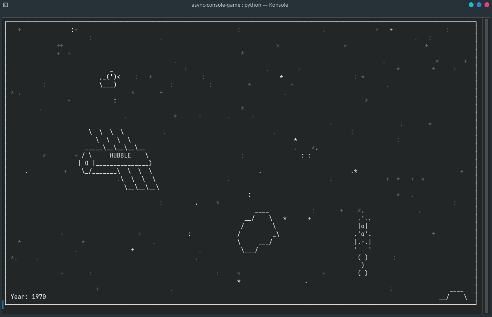

# Async Console Space Game

[](https://www.python.org/)
[](https://docs.python.org/3/library/asyncio.html)
[](https://docs.python.org/3/library/curses.html)
[](#)
[](#)

Консольная аркада на Python: управляемый космический корабль, орбитальный мусор, столкновения, взрывы, прогрессия по годам и игровой сценарий — всё в терминале на базе `curses` и асинхронных корутин.

Проект демонстрирует практические навыки разработки на Python: проектирование асинхронной логики, организация игрового цикла, работа с коллизиями, анимацией и модульной структурой кода. Подходит как портфолио-пример для позиций, связанных с Python-разработкой.

## Скриншот




## Возможности

- **Анимированное звездное поле** — независимое мерцание множества звезд с разными символами и фазами.
- **Управление кораблем** — плавное перемещение с инерцией и затуханием скорости (физическая модель управления).
- **Покадровая анимация** — смена ASCII-кадров корабля и эффектов взрыва.
- **Космический мусор** — случайные объекты (спутник, утка, лампа, обломки и т.д.) падают с орбиты.
- **Система коллизий** — отслеживание столкновений корабля/выстрелов с препятствиями через bounding-box логику.
- **Стрельба плазменной пушкой** — доступна с 2020 года (по игровому сценарию) по нажатию пробела.
- **Взрывы и уничтожение мусора** — при попадании снаряда объект исчезает с анимацией взрыва.
- **Game Over** — при столкновении корабля с мусором отображается экран окончания игры.
- **Игровой сценарий и таймлайн** — счетчик лет, исторические события и изменение сложности со временем (частота появления мусора растет).

## Игровая прогрессия (сценарий)

В игре идет отсчет лет (начиная с 1957) с отображением ключевых событий эпохи освоения космоса. Параметры геймплея меняются по мере прохождения времени:

| Период | Событие / особенность | Появление мусора |
|---|---|---|
| 1957 | First Sputnik | нет |
| 1961 | Gagarin flew! | редко |
| 1969 | Armstrong got on the moon! | чаще |
| 1981 | Flight of the Shuttle Columbia | средне |
| 1995+ | — | активно |
| 2010+ | — | часто |
| 2020+ | **Take the plasma gun! Shoot the garbage!** | очень часто, доступна стрельба |

## Демонстрируемые навыки

Проект полезен как пример компетенций для технического собеседования и портфолио:

- **Python (stdlib)** — работа с модулями, файлами, структурами данных, ООП (`Obstacle`) и чистыми функциями.
- **Асинхронное программирование (`asyncio`)** — множество независимых корутин (фон, мусор, корабль, выстрелы, HUD, таймер лет) в рамках одного процесса.
- **Кооперативная многозадачность** — собственный цикл исполнения корутин через `send(None)` и управление их жизненным циклом.
- **Терминальный UI (`curses`)** — неблокирующий ввод, отрисовка/стирание кадров, подокна (`derwin`), работа с размерами экрана.
- **Игровая логика** — игровой цикл, столкновения, обработка состояний (активная игра / game over), спавн объектов, прогрессия сложности.
- **Физика управления** — плавное изменение скорости, ограничение максимума, инерция и затухание движения.
- **Модульная архитектура** — разделение ответственности по модулям (`physics`, `obstacles`, `space_garbage`, `explosion`, `game_scenario`, `curses_tools`).
- **Работа с ресурсами** — загрузка ASCII-кадров/ассетов из файлов.

## Структура проекта

```text
.
├── game.py              # Точка входа, игровой цикл, сценарные корутины и связывание логики
├── curses_tools.py      # Ввод, отрисовка кадров, утилиты размеров
├── physics.py           # Плавное управление скоростью и инерцией корабля
├── obstacles.py         # Модель препятствий и проверка коллизий
├── space_garbage.py     # Генерация/движение космического мусора
├── explosion.py         # Анимация взрыва
├── game_scenario.py     # Таймлайн лет, фразы и параметры сложности
├── frames/              # ASCII-кадры (корабль, мусор, game over)
│   ├── rocket_frame_1.txt
│   ├── rocket_frame_2.txt
│   ├── game_over.txt
│   ├── duck.txt
│   ├── hubble.txt
│   ├── lamp.txt
│   ├── trash_small.txt
│   ├── trash_large.txt
│   └── trash_xl.txt
└── docs/
    ├── screenshot.png   # Реальный кадр игры для README
    └── screenshot.txt   # Текстовая версия кадра
```

## Требования

- Python 3.x
- Терминал с поддержкой `curses`
- Стандартная библиотека Python (`asyncio`, `curses`, `random`, `time`, `math`)

> На Linux/macOS `curses` обычно доступен из коробки. На Windows может потребоваться пакет `windows-curses`.

## Запуск

Из корня проекта:

```bash
python3 game.py
```

Рекомендуется запускать в терминале достаточного размера, чтобы объекты, анимации и HUD отображались корректно.

## Управление

| Клавиша | Действие |
|---|---|
| `↑` / `↓` / `←` / `→` | Управление движением корабля |
| `Пробел` | Выстрел (доступен с 2020 года по сценарию) |

## Технические детали реализации

- **Корутины и планирование:** `game.py` поддерживает список активных корутин и на каждом шаге цикла продвигает их вручную, удаляя завершившиеся.
- **Коллизии:** препятствия хранятся в общем списке; выстрелы и корабль проверяют пересечения с объектами мусора.
- **Жизненный цикл мусора:** объект добавляется в список препятствий при создании и корректно удаляется после выхода за экран или уничтожения.
- **Сложность:** частота спавна мусора определяется функцией `get_garbage_delay_tics(year)` и меняется по ходу сценария.
- **UI:** нижняя строка (HUD) отображает текущий год и контекстную фразу сценария.

## Идеи для дальнейшего развития

- Подсчет очков и таблица рекордов.
- Несколько жизней/уровней прочности корабля.
- Пауза и перезапуск игры без выхода из процесса.
- Обработка изменения размера терминала в рантайме.
- Настраиваемые параметры сложности/управления.

